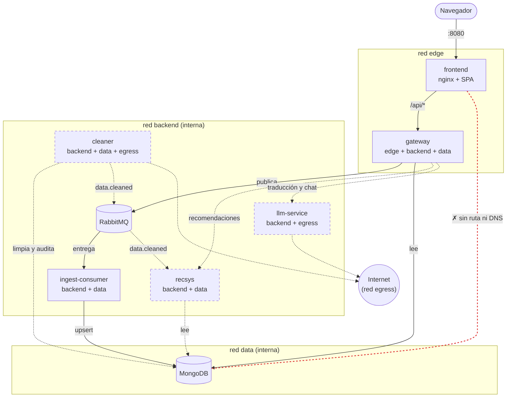
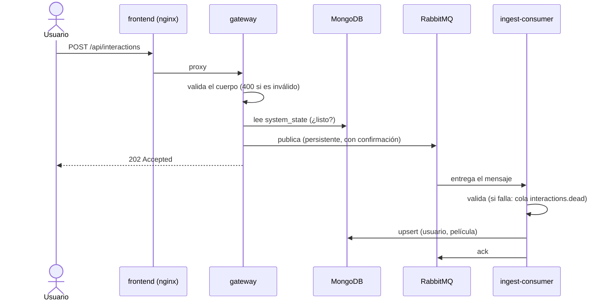

# DCIC-Flix26

Plataforma web de catálogo cinematográfico basada en microservicios y orquestada con Docker Compose. Proyecto final de *Tópicos Avanzados de Desarrollo Web* (DCIC, UNS, 2026).

El catálogo (~20.000 películas y ~61.000 reseñas derivadas de *sample_mflix*) llega con anomalías de calidad deliberadas. Un agente de limpieza con LLM las sanea, un motor de recomendaciones precomputado sirve sugerencias en menos de 100 ms, y las valoraciones de los usuarios se ingestan de forma asincrónica a través de RabbitMQ.

## Estado del proyecto

> Esta tabla es solo para la etapa de desarrollo. Se elimina en la entrega.

| Componente | Estado |
|---|---|
| Infraestructura: Compose, redes aisladas, healthchecks, volúmenes | Implementado |
| Gateway: catálogo, reseñas, estado del sistema, publicación de interacciones | Implementado |
| Ingest-consumer | Implementado |
| Frontend: catálogo, ficha, selector de usuario, votos, aviso de curación | Implementado |
| Agente de limpieza + LLM + auditoría | En desarrollo |
| Vista `/audit` | Pendiente |
| Motor de recomendaciones | En desarrollo |
| Traducción / chat con LLM en la interfaz | Pendiente |

## Cómo ejecutarlo

Requisitos: Docker Desktop (Compose v2). No hay pasos manuales.

```bash
git clone https://github.com/Matrosbu/TADW-2026.git
cd TADW-2026
docker compose up --build
```

Abrir <http://localhost:8080>. Es el único puerto publicado.

- **Primer arranque (frío):** MongoDB importa el dataset de `dataset/` (1 a 2 minutos). Mientras el sistema procesa los datos, la interfaz permite explorar el catálogo y avisa que la curación está en curso (ver [Arranque en frío vs. caliente](#arranque-en-frío-vs-caliente)).
- **Reinicios (calientes):** `docker compose up` reutiliza los volúmenes de MongoDB y RabbitMQ; el dataset no se vuelve a importar.
- **Empezar de cero:** `docker compose down -v` elimina los volúmenes y el siguiente arranque vuelve a ser en frío.
- **Configuración:** los valores de desarrollo están como defaults en `docker-compose.yml` para que el sistema arranque sin configurar nada. Se pueden sobrescribir con un archivo `.env` (ver `.env.example`).

## Arquitectura

### Servicios

| Servicio | Tecnología | Responsabilidad | Redes |
|---|---|---|---|
| `frontend` | nginx 1.27 + SPA en JavaScript puro | Sirve la interfaz, reenvía `/api/*` al gateway y fija la política de seguridad de contenido (CSP) | `edge` |
| `gateway` | Python 3.12, FastAPI | Única API pública: catálogo, reseñas, estado del sistema. Publica las interacciones en RabbitMQ | `edge`, `backend`, `data` |
| `ingest-consumer` | Python 3.12, aio-pika, PyMongo | Consume la cola `interactions`, valida y persiste en MongoDB | `backend`, `data` |
| `mongo` | `mongo:8.0` (imagen oficial) | Catálogo, reseñas, auditoría y estado del sistema | `data` |
| `rabbitmq` | `rabbitmq:4-management` (imagen oficial) | Mensajería: ingesta de interacciones y eventos entre servicios | `backend` |
| `cleaner` *(en desarrollo)* | Python | Agente de limpieza con LLM y registro de auditoría | `backend`, `data`, `egress` |
| `recsys` *(en desarrollo)* | Python | Índices en memoria y API de recomendaciones | `backend`, `data` |
| `llm-service` *(en desarrollo)* | Python | Traducción y chat; custodia de la clave del LLM | `backend`, `egress` |

### Redes y aislamiento



Línea punteada: componentes en desarrollo.

| Servicio | `edge` | `backend` (interna) | `data` (interna) | `egress` |
|---|:---:|:---:|:---:|:---:|
| `frontend` | ✔ | | | |
| `gateway` | ✔ | ✔ | ✔ | |
| `ingest-consumer` | | ✔ | ✔ | |
| `rabbitmq` | | ✔ | | |
| `mongo` | | | ✔ | |
| `cleaner` *(en desarrollo)* | | ✔ | ✔ | ✔ |
| `recsys` *(en desarrollo)* | | ✔ | ✔ | |
| `llm-service` *(en desarrollo)* | | ✔ | | ✔ |

**Por qué esta topología**

- **El frontend no puede alcanzar MongoDB.** Solo comparte red con el gateway. El DNS de Docker únicamente resuelve nombres de servicios que están en una red en común, así que desde el contenedor del frontend `mongo` ni siquiera se resuelve. Todo acceso a datos pasa por el gateway, que valida cada petición.
- **`backend` y `data` son redes internas** (`internal: true`): sin salida a internet y sin acceso desde el host. Lo único expuesto al exterior es el puerto 8080 del frontend; ni MongoDB ni RabbitMQ (ni su consola de administración) publican puertos.
- **Mínimo privilegio.** Cada servicio está solo en las redes que necesita: el consumer no está en `edge`; RabbitMQ no está en `data`; MongoDB no está en `backend`.
- **`egress` es la única red con salida a internet**, reservada para los servicios que llaman a un LLM externo (`cleaner` y `llm-service`). La clave del LLM nunca llega al navegador: las llamadas pasan por el backend.

**Cómo comprobarlo**

```bash
docker compose exec frontend getent hosts gateway   # resuelve
docker compose exec frontend getent hosts mongo     # sin salida: no resuelve
docker compose config | grep -B1 -A2 internal       # backend y data son internal: true
```

### Arranque y dependencias

Mongo y RabbitMQ tienen healthchecks (Mongo verifica que el dataset y sus índices ya estén cargados) y los servicios que dependen de ellos esperan con `depends_on: condition: service_healthy`. Los servicios Python reintentan con espera creciente al conectarse a Mongo y RabbitMQ y no asumen que ya están listos. Los datos persisten en los volúmenes `mongo_data` y `rabbitmq_data`; RabbitMQ usa un hostname fijo para que su cola durable sobreviva a `docker compose down` / `up`.

### Flujo de una valoración (voto + comentario)



El cliente nunca espera a la base de datos: el gateway responde `202` apenas RabbitMQ confirma la recepción. Garantías:

- **Sin pérdida de mensajes:** cola durable, mensajes persistentes y confirmación de publicación; el consumer hace `ack` manual solo después de escribir en MongoDB.
- **Absorción de ráfagas y caídas:** si MongoDB no responde, el consumer devuelve el mensaje a la cola (`nack` con reencolado) y sigue vivo; si no hay consumer, los mensajes esperan en la cola. Si RabbitMQ se reinicia, gateway y consumer se reconectan solos.
- **Un voto por usuario y película:** el último reemplaza al anterior (`upsert`). Un mensaje reentregado no duplica nada (índice único parcial sobre `interaction_id`).
- **Mensajes inválidos:** se rechazan sin reencolar y quedan en la cola de mensajes muertos `interactions.dead` para su análisis.

### Contrato de mensajería

Cola `interactions` (durable). Productor: `gateway`. Consumidor: `ingest-consumer`.

```json
{
  "interaction_id": "uuid-v4",
  "user_id": "usr_0001",
  "movie_id": "573a1397f29313caabce8475",
  "rating": 4,
  "comment": "texto de 1 a 1000 caracteres",
  "ts": "2026-11-25T12:00:00Z"
}
```

| Elemento | Detalle |
|---|---|
| Validación | `user_id` entre `usr_0001` y `usr_2000`; `movie_id` de 24 hexadecimales y película existente; `rating` entero de 1 a 5; `comment` de 1 a 1000 caracteres; `ts` en UTC |
| Mensajes muertos | exchange `interactions.dlx` (direct) → cola `interactions.dead` |
| Tipos en MongoDB | `movie_id` se guarda como `ObjectId` y `date` como `ISODate` |

Cada servicio declara sus colas e intercambios al arrancar, de forma idempotente: no hace falta configurar nada en RabbitMQ a mano.

### Arranque en frío vs. caliente

La fuente de verdad del estado es el documento `system_state` (`_id: "pipeline"`) en MongoDB; los eventos de RabbitMQ solo avisan, así un servicio que arranca tarde no pierde ninguna señal.

```json
{
  "cleaning": { "status": "pending | running | done", "step": "...", "progress": { "done": 0, "total": 0 } },
  "recsys":   { "status": "pending | building | ready" }
}
```

El gateway deriva una fase y la expone en `GET /api/status`:

| Fase | Condición | Catálogo y reseñas previas | Recomendaciones y nuevas valoraciones |
|---|---|:---:|:---:|
| `curating` | `cleaning.status != done` (o no hay documento) | Disponible | Bloqueadas |
| `indexing` | limpieza lista, `recsys.status != ready` | Disponible | Bloqueadas |
| `ready` | ambos listos | Disponible | Habilitadas |

- **Bloqueo en el servidor, no solo en la interfaz:** mientras la fase no sea `ready`, `POST /api/interactions` responde `503` con `Retry-After`.
- **La ingesta sigue desacoplada de MongoDB:** si Mongo no responde al consultar el estado, el gateway acepta el voto solo si la última fase conocida fue `ready` (RabbitMQ lo absorbe). Si nunca pudo leer el estado, lo rechaza.
- **Interfaz:** un aviso muestra el paso y el progreso de la curación, el formulario de valoración permanece deshabilitado y, al pasar a `ready`, se habilita solo (sin recargar) y el catálogo se actualiza con los datos ya limpios.
- **Arranque en caliente:** si `cleaning.status` ya es `done`, el agente de limpieza no repite el proceso y la interfaz arranca habilitada desde el primer instante.

> **PENDIENTE:** completar cuando estén integrados el agente de limpieza y el recomendador: qué escribe cada uno en `system_state`, eventos `data.cleaned` y `recsys.ready` del exchange `pipeline`, y tiempo medido de un arranque en caliente.

### API del gateway

Los errores siempre son JSON `{ "error": "mensaje" }` con el código HTTP correcto.

| Método y ruta | Descripción |
|---|---|
| `GET /api/movies?genre=&q=&page=&size=` | Catálogo paginado (`size` de 1 a 50). `genre`: coincidencia exacta; `q`: búsqueda por título |
| `GET /api/movies/{id}` | Ficha completa de una película |
| `GET /api/movies/{id}/reviews?page=&size=` | Reseñas de la película, las más recientes primero. Nunca incluyen el correo del usuario |
| `GET /api/genres` | Géneros disponibles |
| `GET /api/status` | Fase del sistema (`curating`, `indexing`, `ready`) con paso y progreso |
| `POST /api/interactions` | Publica una valoración. `202` aceptada; `400` inválida; `503` sistema procesando datos o broker no disponible |

Las respuestas paginadas tienen la forma `{ "items": [...], "page": n, "size": n, "total": n }`.

> **PENDIENTE:** agregar `GET /api/recommendations`, `GET /api/movies/{id}/similar`, `GET /api/audit/*`, y las rutas de traducción y chat cuando existan.

## Agente de limpieza y uso del LLM

Anomalías relevadas en el dataset crudo (19.842 películas, 61.488 reseñas):

| Colección | Anomalía | Cantidad |
|---|---|---|
| `movies` | Películas duplicadas (filas sobrantes tras normalizar el año; 333 de 667 grupos tienen reseñas en más de una copia) | 712 |
| `movies` | Año como texto (`"2010è"`, `"circa 2013"`) / negativo / nulo | 321 / 90 / 113 |
| `movies` | Duración como texto (`"1h 30m"`, `"100 min"`) / negativa / mayor a 600 | 255 / 78 / 9 |
| `movies` | Géneros como texto con separadores `, `, `\|`, ` / ` (y elementos con espacios) | 378 |
| `movies` | `imdb.rating` como texto / `-1` / mayor a 10 (escala x10 y 61 casos de `14.5`) | 153 / 57 / 193 |
| `movies` | `imdb.votes` como texto (`"2,819"`) | 424 |
| `movies` | Títulos con espacios espurios | 417 |
| `reviews` | `rating` nulo (todas con comentario utilizable) | 928 |
| `reviews` | `rating` fuera de rango (`-1`, `0`, `6`, `10`, `100`, `999`) / como texto | 1.211 / 873 |
| `reviews` | Comentarios basura (`"..."`, `""`, `none`, `test`) y otros del estilo `ok`, `idk`, `???`, `asdf` | 525 + ~1.050 |
| `reviews` | Huérfanas (`movie_id` inexistente) | 350 |
| `reviews` | Pares (usuario, película) repetidos | 458 |
| `reviews` | Fechas no ISO (`yesterday`, `circa 2020`, `dd/mm/yyyy`, epoch en ms) / futuras | 910 / 29 |
| `reviews` | Usuario anónimo (`user_id` vacío o `usr_0000`) | 459 |

> **PENDIENTE:** estrategia de limpieza (reglas determinísticas por anomalía y decisiones sobre los casos ambiguos), uso del LLM (modelo elegido, por qué, prompt, y exactitud medida contra las reseñas con rating conocido), manejo de fallos del LLM, y cómo se garantiza que el proceso es reanudable y no se repite en el arranque en caliente.

## Auditoría: ruta oculta `/audit`

> **PENDIENTE:** confirmar que `/audit` está implementada y accesible por URL directa (sin enlace en la navegación pública), y describir las métricas macro y el detalle antes/después de los registros modificados.

## Motor de recomendaciones

> **PENDIENTE:** estrategia algorítmica adoptada y por qué, cómo se precomputa (índices en memoria al arrancar, sin entrenar ni recorrer el catálogo en la petición), manejo del arranque en frío de usuarios sin historial, y latencia medida (objetivo: menos de 100 ms).

## Integraciones con LLM en la interfaz

> **PENDIENTE:** traducción multilingüe y/o asistente cinéfilo conversacional: qué se implementó, qué modelo usa, y cómo se protege la clave (solo en el backend).

## Seguridad

- **Sin secretos en el repositorio:** la configuración llega por variables de entorno. Los valores por defecto del compose son solo de desarrollo; para otro entorno se sobrescriben con `.env`.
- **Contenido de usuarios tratado como no confiable:** la interfaz construye el DOM con `textContent` (sin `innerHTML` con datos) y nginx envía una CSP restrictiva (`script-src` y `style-src` solo `'self'`) y `X-Content-Type-Options: nosniff`.
- **Datos personales:** el correo de los usuarios nunca sale por la API.
- **Validación en la frontera:** el gateway valida cada petición, y el consumer vuelve a validar cada mensaje; el texto de búsqueda se escapa antes de usarse como expresión regular.

## Estructura del repositorio

```text
.
├── docker-compose.yml     # orquestación: servicios, redes, volúmenes, healthchecks
├── .env.example           # variables de entorno configurables
├── dataset/               # semillas de la cátedra y script de inicialización de MongoDB
├── gateway/               # API pública (FastAPI): catálogo, estado, publicación en RabbitMQ
├── ingest-consumer/       # consumidor de la cola interactions
├── frontend/              # nginx + SPA (public/)
└── docs/                  # diseño y contratos entre servicios (diseno.md), enunciado
```

## Decisiones y limitaciones conocidas

- Gateway y consumer usan hoy el usuario administrador de MongoDB; queda pendiente un usuario de aplicación con permisos mínimos.
- Mientras el agente de limpieza trabaja, el catálogo muestra los datos aún sin sanear (por diseño: la exploración nunca se bloquea).
- La búsqueda por título recorre la colección (~150 ms con 20.000 películas); alcanza para este volumen y evita un índice de texto.
- Contrato completo entre servicios y decisiones abiertas: [`docs/diseno.md`](docs/diseno.md).
